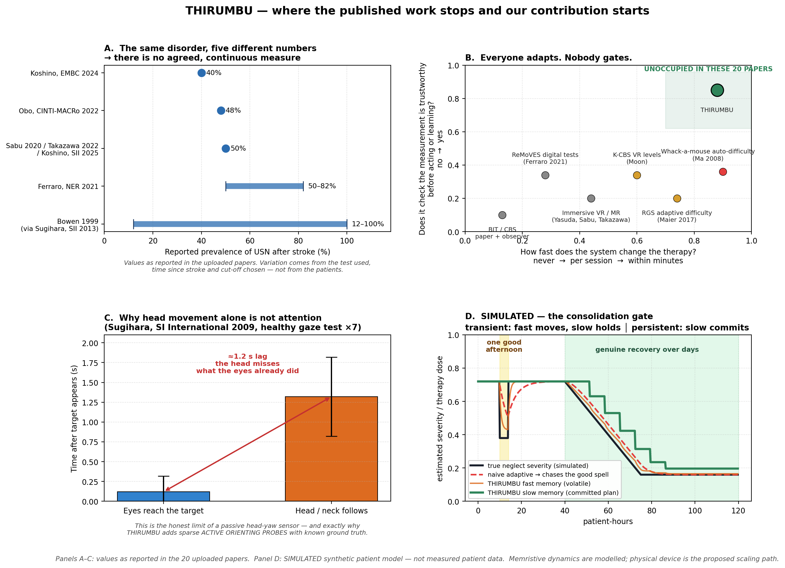

# THIRUMBU (LeftSense)

**Consolidation-Gated Closed-Loop Therapy Dosing for Post-Stroke Hemispatial Neglect**

**Author and lead developer: Saiyugan Jegan** (B.E. ECE, College of Engineering, Guindy, Anna University)

🏆 **Winning Round-2 entry, MedEvolv ’26 Ideathon** (Biomedical Engineers Association, CEG, 26 Sep 2026)

> Simulation on a synthetic patient model. Not a medical device, not clinically validated, and it diagnoses nothing.



---

## The problem

A patient recovering from hemispatial neglect and a machine adjusting their therapy are **both changing at the same time**. The machine must decide which improvements are real enough to commit to, and must not "learn" from bad data such as a patient lying on their left side.

## The idea

```
G_total = G_slow + g_fast
```

- **`g_fast`** is volatile. It moves with every confident observation and relaxes away.
- **`G_slow`** is non-volatile. It changes only when the **consolidation gate** opens, which needs confidence **and** directional consistency **and** persistence beyond one waking half-day.
- The same confidence state gates two things:
  1. whether a therapy cue is delivered at all, and
  2. whether the system is allowed to learn.
- A premature commitment can be **rolled back** when later evidence contradicts it.
- The memory is modelled on memristive dynamics. A physical memristive device is the proposed hardware scaling path; no device figures are claimed.

## Results (synthetic patient, `--selftest`)

| Controller | Mean dose error (vs ideal) | Cues on untrustworthy data |
|---|---|---|
| Fixed dose | 0.289 | 108 |
| Naive adaptive | 0.051 | 128 |
| **THIRUMBU** | **0.036** | **15** |

Consolidation specificity and sensitivity: 100 % on the scripted scenarios. The scripted self-test checks every claim above and ends with `SELFTEST: PASS`.

## Run it

No installation and no third-party packages: Python standard library plus tkinter.

```
python src/main.py              # interactive dashboard (the demo)
python src/main.py --selftest   # scripted experiment, headless
```

On Windows, double-click `run.bat`.

## Demo sequence

1. `START CALIBRATION`, then `START MONITORING`
2. `TRANSIENT GOOD SPELL`: fast memory moves, slow memory does not
3. `INVALID CONTEXT`: confidence collapses, cues are withheld and learning is suppressed
4. `PERSISTENT RECOVERY`: wait about 15 s; the consolidation bar fills and slow memory steps down
5. `POWER CYCLE`: volatile state is lost, consolidated state is kept
6. `DETERIORATION`: the dose climbs again

The full talk track is in [`docs/demo_script.md`](docs/demo_script.md).

## Layout

```
src/   main, gui, patient (synthetic model), plasticity (fast/slow memory + gate),
       controllers (fixed, naive, THIRUMBU), metrics, config
docs/  demo script and evidence figure (literature gap + simulated result)
```

## Credits

- **Saiyugan Jegan**: author and lead developer (concept, simulation, controllers and dashboard).
- MedEvolv ’26 Ideathon team: **Saiyugan Jegan**, Shreehan S Nayak, Suchita Venkatesh.

## Licence

**Copyright © 2026 Saiyugan Jegan.** Released under the [PolyForm Noncommercial License 1.0.0](LICENSE).
Free for research, teaching and personal use. Commercial use needs written permission from the author. Keep the copyright notice and credit the author in derived work.
